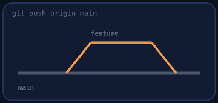
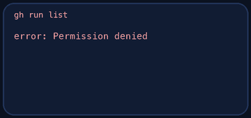
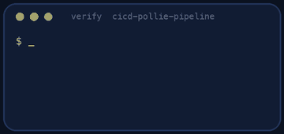
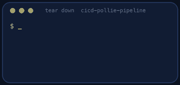

<p align="center"></p>

| | |
|-|-|
| **Time** | 90-120 min |
| **Cost** | free |
| **You need** | A GitHub account, git, the GitHub CLI (`gh auth login`), Docker (optional, to try the image) and a terminal |

## How this lab works

1. **Fork** this repository to your own GitHub account (button at the top right).
2. Clone **your fork** in your Ubuntu environment (WSL on Windows, your OrbStack machine on Mac).
3. Read the lab below (the same text is in [`LAB.md`](LAB.md)) and follow the mission.
4. Answer the questions in [`SUBMISSION.md`](SUBMISSION.md). Where a question asks for output, paste it in a code block. No screenshots needed.
5. Commit and push. Open the **Actions** tab of your fork (click *I understand my workflows, go ahead and enable them* the first time). The **Lab check** shows what is still missing.
6. When the check is green, **submit the URL of your fork** in the course platform.

> [!NOTE]
> The check only looks at your answers and any files the lab asks you to commit. Your instructor reads your work and may ask you to explain any line.

<p align="center"></p>

## 🎬 The situation

<p align="center"></p>

Last Thursday afternoon a teammate merged a small change into `main`. It passed the code review, because the diff looked fine. It broke the vote worker in production for two hours, and a unit test, which nobody ran, would have caught it in three seconds.

Your lead is direct: *"I do not want to rely on people remembering to run the tests. Build a pipeline so a change that breaks Pollie, or ships a known-vulnerable library, cannot reach `main`. And when something does reach `main`, the exact image that passed the checks is what gets published."*

You have Pollie's source code in this repository, a working `Dockerfile` and GitHub Actions. You do not have a pipeline yet.

> [!IMPORTANT]
> **Your mission**
> - Write `.github/workflows/ci.yml` with five jobs: **lint**, **test** (against real PostgreSQL and Redis), **build**, **scan** and **publish**
> - Build the image **once** and publish exactly the image that was scanned, only from `main`
> - Give every job the least privilege it needs
> - Open a pull request that adds a vulnerable dependency, watch the pipeline refuse it, and fix it
> - Pull the published image from GitHub's container registry

**Time:** 90-120 min | **Cost:** free (public repositories get free Actions minutes and free GHCR storage) | **You need:** a GitHub account, git, the GitHub CLI (`gh`), a terminal. Docker is useful to try the final image. `./teardown.sh` removes what the pipeline created.

<p align="center"></p>

## Part 0 - Set the scene

1. **Fork** this repository, keep it **public**, then clone your fork.
2. Open the **Actions** tab of your fork. GitHub switches workflows off in forks until you agree: click **I understand my workflows, go ahead and enable them**.
3. Log in with the GitHub CLI and add the permission to read packages (you need it for the final checks):

```bash
gh auth login
gh auth refresh -s read:packages,delete:packages
```

4. Look around: `docs/POLLIE.md` explains the application, `Makefile` has the commands CI will run, and the `Dockerfile` is the one you know from the Docker block.

Run the checks yourself once (optional, needs Python 3.12): `pip install -r requirements-dev.txt && make check`. **The pipeline will run exactly these commands**, on a machine that is not yours. That is the whole idea.

<p align="center"></p>

## Part 1 - The first job: lint

<p align="center"></p>

Create `.github/workflows/ci.yml`:

- It must run on **pushes to `main`** and on **every pull request**.
- Job `lint` on `ubuntu-latest`: check out the code, set up Python 3.12 **with the pip cache**, install `requirements-dev.txt`, run `make lint`.

Work on a branch, as a team would:

```bash
git switch -c add-ci
git add .github/workflows/ci.yml && git commit -m "Add CI: lint"
git push -u origin add-ci
```

Open the **Actions** tab (or `gh run watch`) and look at the log. Find the step that restored the cache, and the one that installed the dependencies. Then fix any YAML mistakes until the job is green. (`gh run view --log-failed` shows only what went wrong.)

> [!NOTE]
> **Think** `actions/checkout@v4`: the `@v4` pins which version of somebody else's code runs inside your pipeline, with access to your repository. What could go wrong with `@main`? Your pipeline will be checked for this.

<p align="center"></p>

## Part 2 - The test job, with real services

Unit tests are cheap, but Pollie also has tests that need a real PostgreSQL and a real Redis (`make test-integration`, which reads `DATABASE_URL` and `REDIS_URL`). A pipeline can start them for you: **service containers**.

Add a job `test` that:

1. starts **PostgreSQL 16** (user, password and database `pollie` / `devpass` / `pollie`) and **Redis 7** as `services:`, each **with a health check** (`--health-cmd`, interval, retries) so the steps only start when the databases answer;
2. sets `DATABASE_URL` and `REDIS_URL` for the job (on the runner the services are on `localhost`, ports published);
3. runs `make test` (unit tests with a **coverage gate**: below 80% the command fails) and then `make test-integration`.

Push it. If the test job fails at the very first request, think about what a health check is for.

> [!NOTE]
> **Think** Why is "the container started" not the same as "the database accepts connections"? You saw this in the Compose lab. Where is the same idea here?

> [!NOTE]
> **Predict** Remove the health check options from one service and push. Will the job fail every time, or only sometimes? Why is "only sometimes" worse? (Put it back afterwards.)

Open a pull request from `add-ci` to `main` in **your fork** (not the original repository): `gh pr create --fill --repo <you>/<fork>`. Both jobs run on the PR. Do not merge yet.

<p align="center"></p>

## Part 3 - Build once

Add a job `build` that runs **after lint and test** (`needs:`) and builds the image from the `Dockerfile`:

- Use Docker Buildx and `docker/build-push-action`.
- Pass the commit SHA as the build argument `APP_VERSION`.
- Use the **GitHub Actions cache** for layers (`cache-from: type=gha`, `cache-to: type=gha,mode=max`), so that unchanged layers are not rebuilt.
- Do **not** push anything. Write the image to a tarball (`outputs: type=docker,dest=/tmp/pollie-image.tar`) and upload that file as a workflow **artifact** (`actions/upload-artifact`, `retention-days: 1`).

Push, run the pipeline twice, and compare the duration of `build` between the first and the second run.

> [!NOTE]
> **Think** The `scan` and `publish` jobs will not rebuild the image: they take the same tarball. Why is building the image again in the publish job (a second time, maybe with a slightly different result) a bad idea for a security scan?

<p align="center"></p>

## Part 4 - Scan: the pipeline says no

Add a job `scan` (`needs: build`) that downloads the artifact and runs [Trivy](https://trivy.dev) against **the image tarball** and against **the dependency files** of the repository. The job must **fail** when it finds a vulnerability with severity `HIGH` or `CRITICAL` that has a fix available.

You can use the official container, so there is no third-party action to trust inside your pipeline:

```bash
docker run --rm -v /tmp:/tmp aquasec/trivy:0.75.0 image \
  --input /tmp/pollie-image.tar --severity HIGH,CRITICAL --ignore-unfixed --exit-code 1
docker run --rm -v "$PWD:/src" aquasec/trivy:0.75.0 fs \
  --scanners vuln --severity HIGH,CRITICAL --ignore-unfixed --exit-code 1 /src
```

`--exit-code 1` is what turns a report into a **gate**; `--ignore-unfixed` skips findings nobody can fix yet (otherwise you would block releases for problems with no remedy).

> [!NOTE]
> **Think** Without `--exit-code 1` Trivy prints a report and exits `0`. The pipeline is green. Who reads a report nobody is forced to read?

<p align="center"></p>

## Part 5 - Publish: only from `main`, only what was scanned

Add the job `publish` (`needs: scan`) that:

1. runs **only** for pushes to `main` (`if: github.event_name == 'push' && github.ref == 'refs/heads/main'`);
2. is the **only** job with `permissions: packages: write` (plus `contents: read`);
3. downloads the artifact, loads the image (`docker load -i ...`), logs in to `ghcr.io` with `docker/login-action` and the automatic `GITHUB_TOKEN`, and pushes it with **two tags**: the full commit SHA and `latest`.

The registry name is `ghcr.io/<your-user>/<your-repo>`, **in lower case** (GHCR refuses upper case: use `tr '[:upper:]' '[:lower:]'` on `${{ github.repository }}`).

Also at the top of the workflow, once and for all:

```yaml
permissions:
  contents: read          # every job gets only this, unless it asks for more

concurrency:
  group: ci-${{ github.ref }}
  cancel-in-progress: true
```

> [!NOTE]
> **Think** `permissions: contents: read` at the top means a compromised third-party action in the `lint` job cannot push code or write packages. Only the `publish` job can write packages, and only on `main`. Why is a pull request from somebody else's fork never given those rights, and why should the publish job never run on `pull_request`?

Merge your PR (`gh pr merge --squash`). Watch the run on `main`: all five jobs should be green, and `publish` should have run.

<p align="center"></p>

## Part 6 - Break it on purpose

On a new branch, add a dependency with a known vulnerability to `requirements.txt`:

```bash
git switch -c vulnerable-dependency
echo "urllib3==1.26.4" >> requirements.txt
git commit -am "Add urllib3" && git push -u origin vulnerable-dependency
gh pr create --fill --repo <you>/<fork>
```

1. Watch the pipeline. Which job goes red, and which jobs do not even run? Read the table of findings in the log.
2. The fix: upgrade to a version above all the "Fixed Version" values (look at the newest one; `pip index versions urllib3` helps). Push and see the pipeline turn green.
3. You may merge the fixed PR or close it; Pollie does not need this library.
4. While the run is going, push a second commit to the PR branch. What happened to the first run? (That is the `concurrency` block.)

> [!NOTE]
> **Think** The vulnerable library is only in `requirements.txt`: Pollie never imports it. Is the image still vulnerable? What does an attacker need to exploit a library that is installed but never loaded? Is "not used" a safe assumption?

<p align="center"></p>

## Part 7 - Use what you published

```bash
gh auth token | docker login ghcr.io -u <you> --password-stdin
docker pull ghcr.io/<you>/<repo>:latest
docker image inspect ghcr.io/<you>/<repo>:latest --format '{{.Config.User}} {{.Config.Labels}}'
```

Which user does the container run as? Which version label is inside? Compare the image ID of the `:latest` and the `:<sha>` tags. (If the package is private by default, that is fine for this lab.)

> [!NOTE]
> **Think** `latest` is a pointer that moves with every merge. Tomorrow `latest` means something else. What would you deploy to production instead, and what does the SHA tag give you when something breaks at 03:00?

<p align="center"></p>

## Part 8 - Prove it

<p align="center"></p>

```bash
./verify.sh
```

It looks at your workflow file and at what GitHub recorded: a green run on `main` with all five jobs, a pull request that went red and then green, and the published package. Fix what is red and run it again until it ends with **ALL CHECKS PASSED**.

> [!TIP]
> **Stuck?** `gh run list`, `gh run view <id> --log-failed` and the **Actions** tab are your friends. A `403` when pushing the image means the job lacks `packages: write` or the registry name has upper case letters. The `services:` block needs the keys `image`, `env`, `ports` and `options`. If `verify.sh` says the package does not exist and you published, run `gh auth refresh -s read:packages` first.

<p align="center"></p>

## Level up (optional)

- Add a `workflow_dispatch:` trigger and a nightly `schedule:` that re-runs the scan on `main`: a library that was clean on Monday can have a CVE on Friday.
- Make `test` a matrix over Python 3.11, 3.12 and 3.13, as the Pollie project does. What does that cost in minutes?
- Turn on **branch protection** for `main` in your fork (Settings → Branches) and require the checks `lint`, `test` and `scan` before merging. What can still reach `main`?
- Add `docker/metadata-action` to generate tags and labels instead of writing them by hand.

<!-- teardown:start (generated by labs.py, do not edit) -->
## Tear down (mandatory)

<p align="center"></p>

Resources left behind cost money, keep doors open and pollute the next lab. Removing what you created is part of the job, so it is part of the submission: **you must prove it is gone**.

Do this **last**, after you have pasted your `verify` output into `SUBMISSION.md` (once you tear down, the lab can no longer be verified).

1. Run `gh auth refresh -s read:packages,delete:packages` once (you did it in Part 0), then `./teardown.sh`. It deletes the container package your pipeline published to GHCR, the artifacts of your fork, and disables your CI workflow. Your code, the workflow file and the run history stay.

Then run the proof:

```bash
./verify-teardown.sh
```

It prints a list of checks and must end with **TEARDOWN VERIFIED**. If it reports leftovers, remove them and run it again. Paste the full output in your submission.
<!-- teardown:end -->

<!-- submission:start (generated by labs.py, do not edit) -->
## 📬 Submission

Answer the questions in `SUBMISSION.md` in **your fork** (paste output in code blocks where asked), push, then submit the **URL of your fork**.

**Files to commit**

- `.github/workflows/ci.yml`: your pipeline

**Questions to answer**

1. Paste the URL of your last green run on `main` and the names of its jobs with their durations. Which jobs run in parallel and which wait for others (`needs:`), and why did you order them that way?
2. Your `test` job uses `services:` for PostgreSQL and Redis. Paste that block. Why `--health-cmd` on the services, why the host `localhost` in the URLs, and what would happen without the health check?
3. Paste the URL of the pull request where CI went red because of the vulnerable dependency, the failing step with the CVE lines, and the fix. Why does the `scan` job fail the build instead of just reporting, and what does `ignore-unfixed` change?
4. Show the `permissions:` of your workflow. Which job is the only one that can write packages, and what does the top-level `contents: read` protect you from if a third-party action is compromised?
5. Paste the `concurrency:` block and explain what happens when you push twice in a row to a pull request. Where did you use a cache, and how much time did it save (compare two runs)?
6. Paste the `docker pull` of the image you published and `docker image inspect` showing its tags. Which tags did you publish (commit SHA, `latest`, branch?) and why is `latest` alone a bad idea?
7. Why do pull requests from forks not get write permissions or secrets, and why does the publish job only run on `main`? What attack does this prevent?
8. Paste the output of `./verify.sh`. It must end with **ALL CHECKS PASSED**.
9. **Tear down.** Paste the output of `./verify-teardown.sh`. It must end with **TEARDOWN VERIFIED**.
<!-- submission:end -->
